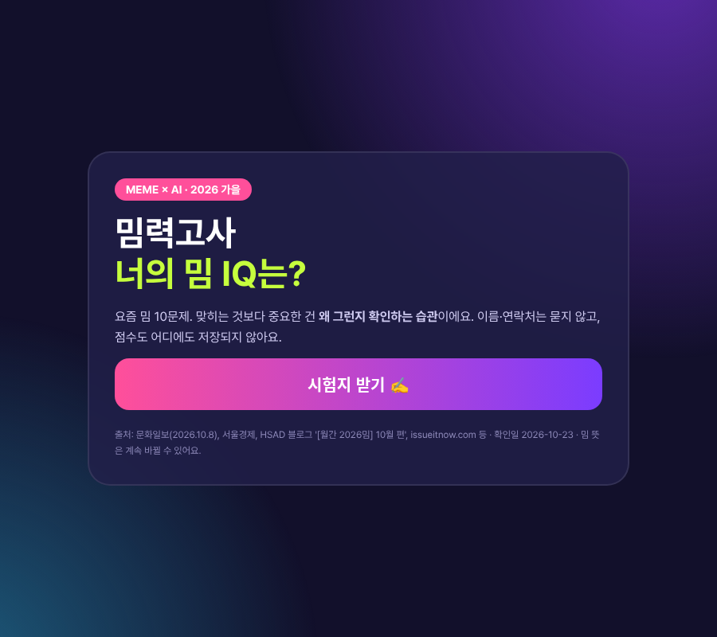

# 밈력고사 2026 · 너 혹시 늙크크?

중고등학생 대상 "요즘 밈, AI로 읽고 검증하기" 수업에서 쓰는 10문제 웹 퀴즈입니다.

**바로 풀기:** https://techkwon.github.io/meme-quiz-2026/

## 무엇을 확인하나요
- 요즘 밈 5개(늙크크, 밤티, 줴줴이야, 아자스, ~하는 건 ❌)의 뜻과 쓰는 상황
- AI가 알려 준 밈 뜻을 출처로 검증하기 (가상 AI 응답 사용)
- 조회수, 추천, AI 탐지기 점수를 해석하는 법
- 이 밈을 써도 되는 자리인지 판단하기

## 수업에서 쓰는 법
1. 도입 5분: 링크나 QR로 접속해 혼자 풀기
2. 결과 화면에서 틀린 문제 하나를 골라 실습지에 이유 쓰기
3. 모둠에서 근거를 비교하기

## 안전·개인정보
- 정적 파일(HTML 1개)로만 동작합니다. 서버, 로그인, 분석 추적 코드가 없습니다.
- 이름, 학번, 점수를 저장하거나 외부로 보내지 않습니다.
- 연예인 사진, 원본 밈 캡처, 특정 인물이나 집단을 놀리는 문항은 넣지 않았습니다.
- 깜빡임 효과가 없고, 기기에서 '동작 줄이기'를 켜 두면 애니메이션이 꺼집니다.
- 가상 AI 응답은 실제 서비스 출력이 아니라고 화면에 표시해 두었습니다.

## 출처 (확인일 2026-10-23)
- 문화일보 (2026.10.8), 서울경제, HSAD 블로그 "[월간 2026 밈] 10월 편", issueitnow.com
- 아자스와 ~하는 건 ❌는 출처가 한 곳뿐이라 [확인 필요]입니다.
- 밈의 뜻은 계속 바뀌므로 수업 전에 다시 확인하세요.

## 로컬에서 실행
`index.html`을 브라우저로 열면 인터넷 없이도 돌아갑니다.

## 제작
AI 도움을 받아 제작했고, 내용 검토와 최종 판단은 강사 테크권(박권)이 합니다.
